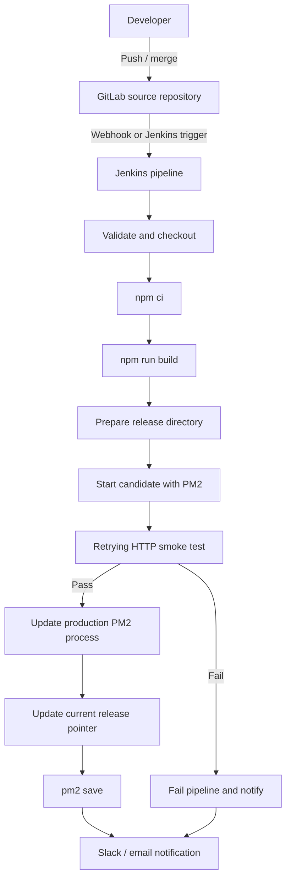

CI/CD Architecture
1. Purpose
This document describes the current Jenkins-based CI/CD setup for the Golobiz Customer API and Business Owner API. The pipeline is intended to validate a change, build the Node.js/TypeScript application, start a candidate instance on a test port, run a smoke check, and then update the production PM2 process.
Implementation note: This documentation reflects the implementation details available at the time it was written. Confirm the live Jenkinsfiles, server configuration, and PM2 process list before treating any item marked "verify" as an operational guarantee. In particular, the Business Owner health-check endpoint and the exact PM2 process names should be verified on the server.

2. Repositories and services
Component	Repository / location	Purpose
Pipeline/documentation repository	vansh4383/Doployment-Pipeline-test-server	Holds pipeline-related work and documentation
Customer API source	golobiz-backend-customer-app-api (GitLab)	Customer-facing backend
Business Owner API source	golobiz-backend-business-owner-api (GitLab)	Business Owner backend
Jenkins	Existing CI server	Checks out source, installs dependencies, builds, deploys, and runs smoke checks
Linux application server	/opt/... deployment directories	Hosts candidate and production application releases
PM2	On the application server	Runs and manages Node.js application processes
Node.js / npm	Jenkins build environment and application server	Installs dependencies and builds the application

The source repositories are separate. Treat the Customer and Business Owner pipelines as separate deployments; do not assume that a successful build of one service validates the other.
3. High-level architecture

The diagram shows the intended flow represented by the pipeline stages. Trigger behavior depends on the Jenkins job configuration and webhook setup; verify whether each job is webhook-triggered or manually started.
4. Service deployment configuration
The currently recorded deployment paths and ports are:
Service	Deployment directory	Candidate/test port	Production port	Smoke-check path
Customer API	/opt/pipeline-pro-customer	5002	4002	/v1/categories
Business Owner API	/opt/pipeline-pro	5001	4000	/v1/health (verify)

The candidate and production ports are service-specific. Do not swap the ports between services. The Customer API smoke-check route is recorded as /v1/categories. The Business Owner route /v1/health was present in the pipeline notes but its successful response was not confirmed; test it manually before relying on it as a release gate.
Release layout
The pipeline prepares release files and uses a current symlink to point at the active release. The exact release-directory naming convention should be taken from the current Jenkinsfile. A typical layout is:
/opt/pipeline-pro-customer/
├── releases/
│   └── <release-id>/
├── current -> releases/<release-id>
└── .env                 # if the implementation stores it here

/opt/pipeline-pro/
├── releases/
│   └── <release-id>/
├── current -> releases/<release-id>
└── .env                 # if the implementation stores it here
This is a conceptual layout. Confirm the actual .env location and whether the symlink is inside the service directory before running commands against it.
5. Jenkins pipeline responsibilities
The Jenkinsfiles currently use stages equivalent to:
1. Validate – check required pipeline inputs/configuration.
2. Checkout – retrieve the relevant GitLab source repository using the configured Git credential.
3. Install – run npm ci for a reproducible dependency installation.
4. Build – run npm run build.
5. Prepare release – copy build output and required runtime files into a release directory; include the service environment file from its configured server location.
6. Candidate deployment – start or restart a candidate PM2 process on the test port.
7. Smoke test – retry an HTTP request against the candidate endpoint.
8. Production deployment – update the production PM2 process after the candidate check passes.
9. Activate release – update the current symlink and run pm2 save.
10. Notification – send success/failure notifications through the configured Slack webhook credential (slack-webhook) and Jenkins email extension (emailext).
Stage names and implementation details can differ slightly between the Customer and Business Owner Jenkinsfiles. The Jenkinsfile in each source/pipeline configuration is the source of truth.
6. Runtime and process management
PM2 runs the Node.js application processes on the Linux server. The pipeline manages separate candidate and production processes so that it can test a candidate build before switching production.

Useful inspection commands:
pm2 list
pm2 status
pm2 logs --lines 100
pm2 describe <process-name-or-id>
Use the exact process name from the Jenkinsfile or pm2 list; do not guess a process name. pm2 save persists the current process list for restoration by the configured PM2 startup service. It does not, by itself, configure the operating-system startup integration.
7. Configuration and secrets
The application requires runtime configuration. The exact variables vary by service and must be read from that service's .env/deployment configuration. Known examples from the application setup include:
- DATABASE_URL
- JWT and OTP secrets
- Cloudflare R2 configuration
- Google Maps configuration
- Groq configuration
These are examples, not a complete or guaranteed list for both APIs. Keep actual secret values out of Git, Jenkins console output, documentation, and notifications. The pipeline notes also refer to a Jenkins Git access credential displayed as access -token; use the exact credential ID configured in Jenkins.

The Slack webhook is referenced through the Jenkins credential ID slack-webhook. Email notifications use the Jenkins Email Extension (emailext) configuration. Verify Jenkins global email settings and credential permissions.
8. Security boundaries
- Do not commit .env files, access tokens, private keys, database passwords, or webhook URLs.
- Restrict Jenkins credentials to the jobs that need them.
- Use least-privilege server accounts and filesystem permissions for deployment directories.
- Avoid printing environment variables or secret-bearing command arguments in build logs.
- Do not expose candidate ports publicly unless required. Prefer localhost or firewall-restricted access for candidate smoke checks.
- Keep production and candidate process names/ports explicit to avoid deploying to the wrong process.
9. Current implementation vs. future improvements
Recorded current implementation
- Separate pipelines/deployment configuration for Customer and Business Owner APIs.
- Jenkins stages for checkout, npm ci, build, release preparation, candidate PM2 deployment, retrying smoke test, production PM2 deployment, release-pointer update, and pm2 save.
- Slack and email notification steps are present in the pipeline notes.
- Customer API candidate/production ports and /v1/categories smoke route are recorded.
Verify before claiming as working
- Exact GitLab webhook trigger behavior.
- Exact release naming and .env file locations.
- Exact PM2 process names and PM2 startup integration.
- Business Owner /v1/health smoke endpoint response.
- Whether rollback restores both the current symlink and the previous PM2 process reliably.
- Whether candidate ports are bound to localhost and protected by firewall rules.
Future improvements (not to be treated as implemented)
- Automated rollback with a verified previous-release health check.
- Deployment locking to prevent concurrent releases to the same service.
- Stronger integration/API tests in addition to smoke checks.
- Artifact retention and automated cleanup of old releases.
- Deployment approvals and environment protection for production.
- Monitoring/alerting after deployment and a post-deployment observation window.
- Infrastructure-as-code and configuration management for repeatable server provisioning.